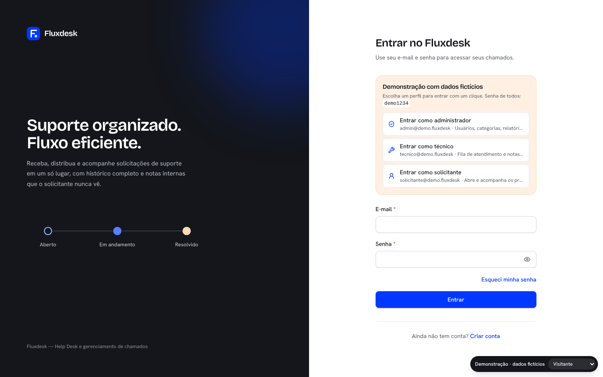
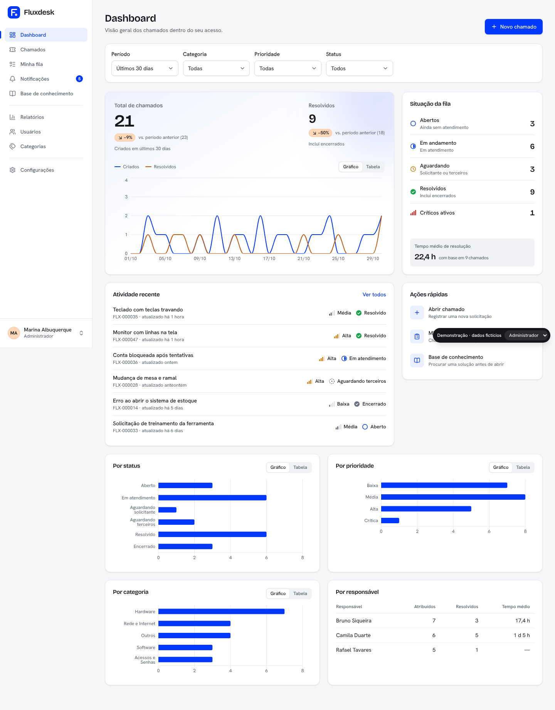
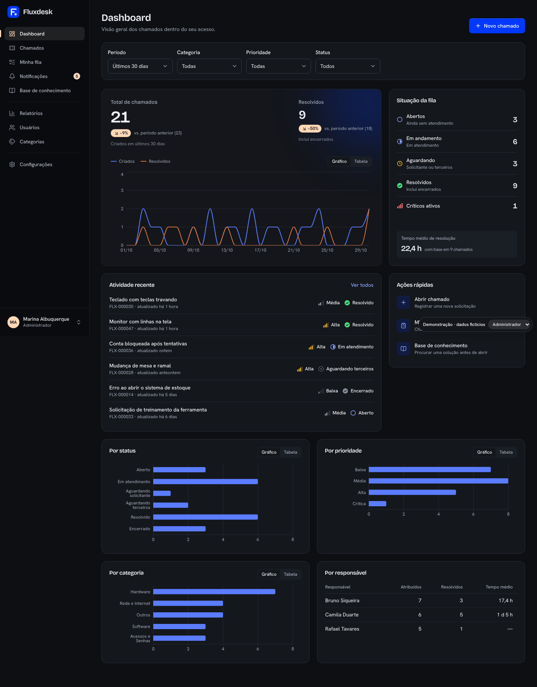
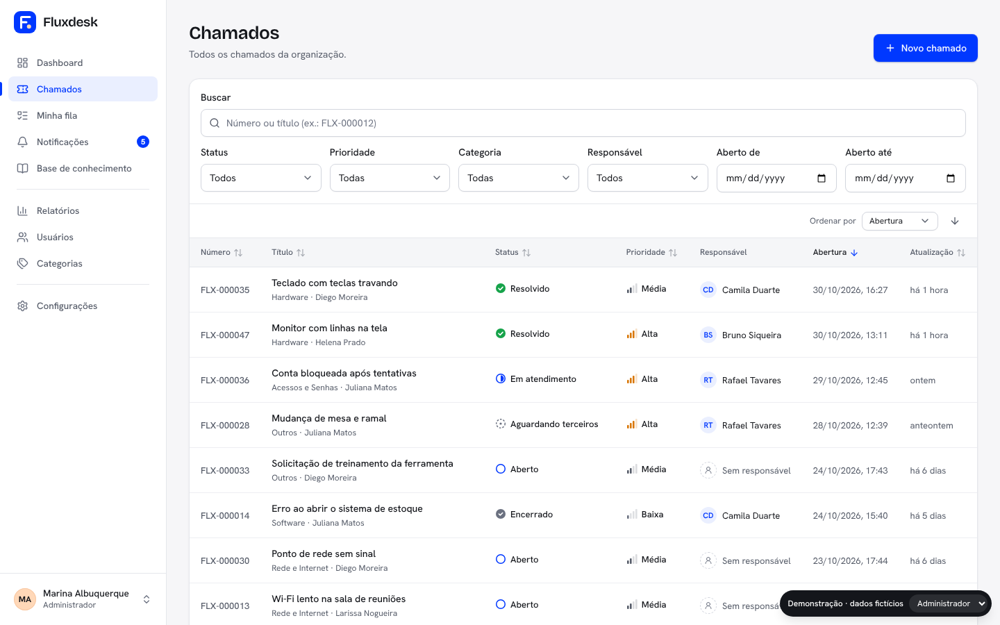
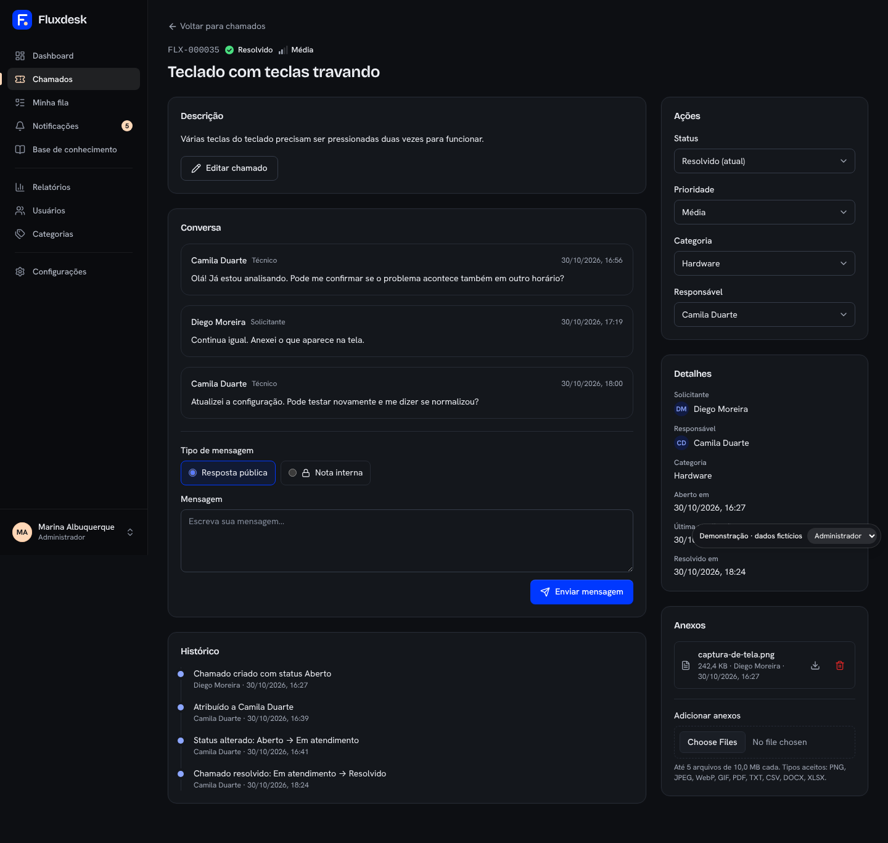
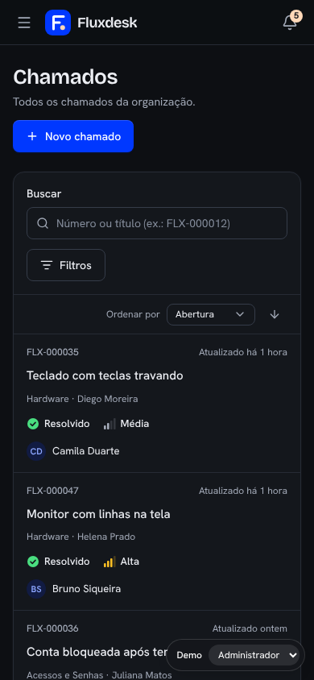

# Fluxdesk

**Suporte organizado. Fluxo eficiente.**

O Fluxdesk é uma plataforma de Help Desk / ITSM desenvolvida em português do Brasil para centralizar solicitações de suporte técnico. Solicitantes abrem chamados, técnicos organizam e atendem solicitações e administradores gerenciam usuários, categorias e configurações do sistema.

Desenvolvido com React e TypeScript no Front-End e Supabase como backend, o projeto utiliza PostgreSQL, Row Level Security (RLS), triggers e funções SQL para implementar suas regras de negócio. Não existe um servidor Node.js separado.

<p align="center">
  <a href="https://fluxdesk-demo.vercel.app/entrar">
    <strong>ACESSAR DEMONSTRAÇÃO ONLINE</strong>
  </a>
  &nbsp;&nbsp;|&nbsp;&nbsp;
  <a href="https://github.com/felipesq0710/fluxdesk">
    REPOSITÓRIO GITHUB
  </a>
</p>

---

## Demonstração online

**Experimente o Fluxdesk:**

[https://fluxdesk-demo.vercel.app/entrar](https://fluxdesk-demo.vercel.app/entrar)

A demonstração pública permite explorar a aplicação por meio de perfis com diferentes níveis de acesso, incluindo administrador, técnico e solicitante.

A versão Demo utiliza exclusivamente dados fictícios armazenados em memória, autenticação simulada e serviços locais. Não utiliza o Supabase de produção e não persiste alterações em um banco de dados real.

As credenciais demonstrativas também estão disponíveis na própria tela de acesso.

## Funcionalidades

### Autenticação e usuários
- Cadastro, login, recuperação e redefinição de senha.
- Sessão persistente.
- Rotas protegidas por perfil.
- Aviso de sessão expirada.
- Tratamento de contas desativadas.
- Gerenciamento de usuários, perfis e permissões.

### Gerenciamento de chamados
- Abertura de chamados com anexos.
- Listagem com busca, filtros e paginação.
- Estado dos filtros armazenado na URL.
- Visualização detalhada dos chamados.
- Comentários públicos e notas internas.
- Histórico automático de alterações.
- Atribuição e liberação de chamados.
- Mudança de status conforme regras de transição.
- Reabertura com prazo configurável.

### Minha fila
Área destinada à equipe de atendimento, com as seguintes categorias:
- Atribuídos a mim.
- Sem responsável.
- Críticos.
- Aguardando solicitante.
- Atualizados recentemente.

### Dashboard
- Indicadores operacionais.
- Gráficos por status, prioridade e categoria.
- Linha do tempo dos chamados.
- Indicadores apresentados conforme as permissões do usuário.

### Relatórios
- Filtros por período, categoria, prioridade, status e responsável.
- Indicadores consolidados.
- Tabela de desempenho por responsável.
- Exportação CSV compatível com Excel em português do Brasil.

### Notificações
- Notificações geradas automaticamente por eventos do sistema.
- Atualizações relacionadas à criação, atribuição, mudança de status, comentários e resolução de chamados.
- Listagem paginada.
- Marcação como lida.
- Contador de notificações não lidas.

### Base de conhecimento
- Criação e edição de artigos.
- Publicação e gerenciamento de rascunhos.
- Categorias e tags.
- Busca de conteúdo.
- Editor com pré-visualização.

### Administração e configurações
- Gerenciamento de usuários.
- Controle de ativação e perfis.
- Gerenciamento de categorias.
- Configurações do sistema.
- Preferências pessoais.
- Alteração de nome e senha.
- Tema claro, escuro e automático.

---

## Stack tecnológica

| Camada | Tecnologias |
|---|---|
| Interface | React 19 |
| Linguagem | TypeScript 6 (strict) |
| Build | Vite 8 |
| Estilização | Tailwind CSS 3 |
| Rotas | React Router 7 |
| Gerenciamento de dados | TanStack Query 5 |
| Formulários | React Hook Form |
| Validação | Zod |
| Gráficos | Recharts 3 |
| Backend | Supabase |
| Banco de dados | PostgreSQL |
| Autenticação | Supabase Auth |
| Armazenamento | Supabase Storage |
| Segurança de dados | PostgreSQL RLS |
| Testes | Vitest, Testing Library, vitest-axe e PGlite |
| Hospedagem | Vercel |

## Arquitetura

O projeto possui uma arquitetura organizada em componentes, páginas, hooks, serviços e módulos de infraestrutura.

### Front-End

- Componentes reutilizáveis organizados por funcionalidade.
- Páginas separadas por módulos da aplicação.
- Hooks para compartilhamento de lógica e gerenciamento de consultas.
- TanStack Query para gerenciamento de dados assíncronos.
- React Router para navegação e proteção de rotas.
- Zod para validação de dados.
- Serviços responsáveis pela comunicação com o backend.

### Backend e banco de dados

O Supabase é utilizado como plataforma de backend, fornecendo:

- Supabase Auth para autenticação.
- PostgreSQL para persistência.
- Row Level Security para controle de acesso aos dados.
- Storage privado para armazenamento de anexos.
- Triggers e funções SQL para regras de negócio, notificações e histórico.

As regras de autorização são aplicadas no banco de dados, não dependendo exclusivamente das verificações realizadas pela interface.

### Organização da aplicação

A aplicação possui separação entre autenticação, componentes, páginas, serviços, regras de negócio, validações e rotas protegidas.

A versão demonstrativa utiliza uma entrada, autenticação e serviços próprios, substituídos por aliases na configuração do Vite. Isso permite compartilhar a interface sem conectar a Demo aos serviços reais de produção.

---

## Produto e Demo: dois ambientes independentes

O Fluxdesk possui duas versões publicadas, com objetivos e configurações diferentes.

| Característica | Produto | Demo |
|---|---|---|
| Objetivo | Aplicação funcional | Apresentação do produto |
| Dados | Dados reais | Dados fictícios |
| Persistência | PostgreSQL | Memória local |
| Autenticação | Supabase Auth | Simulada |
| Backend | Supabase | Serviços locais |
| Variáveis Supabase | Necessárias | Não utilizadas |
| Build | `npm run build` | `npm run build:demo` |
| Diretório | `dist/` | `dist-demo/` |

A versão Demo utiliza `vite.demo.config.ts` para substituir a entrada principal, o provider de autenticação e os serviços que normalmente acessariam o Supabase.

A configuração também utiliza `envDir: false` e um prefixo próprio de variáveis, impedindo o carregamento das variáveis de ambiente do produto.

O build de produção não inclui os módulos da Demo.

### Verificação de isolamento

O projeto possui o comando:

```bash
npm run verify:builds
```

Esse processo constrói os dois ambientes com valores fictícios e verifica a separação dos bundles, procurando referências ao Supabase no build da Demo e marcadores da Demo no build de produção.

A verificação é estática e não substitui testes de navegação ou integração em ambiente real.

---

## Segurança

O Fluxdesk implementa mecanismos de segurança tanto na aplicação quanto no banco de dados.

### Controle de acesso
- Row Level Security habilitado nas tabelas.
- Políticas de acesso por perfil.
- GRANTs por coluna.
- Verificação de conta ativa nas políticas.
- Proteção de campos sensíveis.
- Papel do usuário definido pelo banco, não pelo navegador.

### Proteção dos dados
- Notas internas protegidas por políticas do banco e filtros de notificações.
- Comentários imutáveis.
- Chamados não são excluídos.
- Histórico e notificações gerados por triggers.
- Funções SQL com configurações de segurança específicas.

### Storage
- Bucket privado para anexos.
- Limites de tamanho e tipos de arquivo permitidos.
- Políticas de acesso vinculadas às permissões dos chamados.
- URLs assinadas com validade de 60 segundos.

### Validação e conteúdo
- Validação de formulários com Zod.
- Tratamento de caracteres especiais nas buscas do PostgREST.
- Proteção contra fórmulas executáveis na exportação CSV.
- Renderização controlada do conteúdo da base de conhecimento.
- Mensagens de recuperação de senha que não revelam se um e-mail está cadastrado.

### Credenciais
Somente a chave pública `anon` é utilizada no Front-End. Credenciais administrativas e chaves `service_role` não devem ser disponibilizadas no navegador.

---

## Design system e acessibilidade

O Fluxdesk possui um design system próprio, com tokens CSS, componentes reutilizáveis e temas claro e escuro.

### Identidade visual

| Elemento | Cor |
|---|---|
| Azul principal | `#2457FF` |
| Ciano | `#DFF7FF` |
| Branco | `#FFFFFF` |
| Preto | `#000000` |

A interface utiliza superfícies, bordas, tipografia e estados visuais adaptados aos dois temas.

### Acessibilidade e responsividade

- Navegação por teclado.
- Indicadores de foco visíveis.
- Associação entre campos e rótulos.
- Tratamento acessível de mensagens de erro.
- Diálogos com gerenciamento de foco.
- Gráficos com alternativas em tabela.
- Suporte a `prefers-reduced-motion`.
- Layout responsivo para dispositivos móveis.
- Navegação lateral adaptada para telas menores.

Os testes automatizados de acessibilidade utilizam axe. A revisão manual com leitores de tela reais e dispositivos físicos ainda não foi concluída.

---

## Configuração local

### Requisitos

- Node.js 20.19.0 ou superior (ou 22.12.0 ou superior).
- npm.
- Git.
- Projeto Supabase próprio para executar a versão funcional.

### 1. Clonar o repositório

```bash
git clone https://github.com/felipesq0710/fluxdesk.git

cd fluxdesk
```

### 2. Instalar dependências

```bash
npm install
```

### 3. Configurar variáveis de ambiente

Crie um arquivo `.env.local` na raiz do projeto:

```env
VITE_SUPABASE_URL=sua_url_supabase
VITE_SUPABASE_ANON_KEY=sua_chave_publica
```

As variáveis podem ser encontradas em:

Supabase → Project Settings → API.

Nunca utilize a chave `service_role` no Front-End.

Sem as variáveis necessárias, a aplicação apresenta uma tela de configuração ausente.

### 4. Executar a aplicação funcional

```bash
npm run dev
```

A aplicação será executada localmente utilizando o Supabase configurado no ambiente.

---

## Executando a Demo localmente

A demonstração pode ser executada sem configurar credenciais do Supabase.

```bash
npm run dev:demo
```

Para gerar o build independente:

```bash
npm run build:demo
```

O resultado será gerado no diretório:

```text
dist-demo/
```

---

## Configuração do Supabase

Para executar o produto em um projeto Supabase próprio:

1. Crie um projeto em [supabase.com](https://supabase.com).
2. Acesse Authentication → Providers → Email e habilite o provedor.
3. Configure Site URL e Redirect URLs em Authentication → URL Configuration.
4. Adicione os endereços locais e de produção permitidos.
5. Aplique as migrations.
6. Configure as variáveis de ambiente no `.env.local`.

O aplicativo utiliza autenticação PKCE. O link de redefinição de senha precisa ser aberto no mesmo navegador em que a recuperação foi solicitada.

### Migrations

As migrations versionadas em `supabase/migrations/` devem ser aplicadas em ordem.

| Migration | Conteúdo |
|---|---|
| `20261022000001_schema.sql` | Tipos, tabelas, índices e categorias iniciais |
| `20261022000002_functions_triggers.sql` | Criação de perfil, regras de status, histórico e notificações |
| `20261022000003_rls.sql` | RLS, GRANTs por coluna e funções auxiliares |
| `20261022000004_storage.sql` | Bucket privado e políticas de Storage |
| `20261022000005_reports.sql` | Função de agregação de relatórios |
| `20261022000006_admin_support.sql` | Estatísticas administrativas, categorias e configurações |
| `20261104000001_profile_avatar_and_email_sync.sql` | Avatar de perfil, sincronização de e-mail e políticas de Storage relacionadas |

### Aplicação com Supabase CLI

```bash
npx supabase login

npx supabase link --project-ref SEU_PROJECT_REF

npx supabase db push
```

As migrations devem ser aplicadas na ordem correta. Não pule migrations em caso de erro.

---

## Storage: anexos e avatares

O projeto utiliza buckets privados no Supabase Storage.

### Anexos de chamados

O bucket `ticket-attachments` possui:

- Limite de 10 MB por arquivo.
- Tipos permitidos: PNG, JPEG, WebP, GIF, PDF, TXT, CSV, DOCX e XLSX.
- Políticas de acesso baseadas nas permissões dos chamados.
- URLs assinadas com validade de 60 segundos.

### Avatares de perfil

O bucket `profile-avatars` é privado e utiliza políticas de acesso específicas para os usuários ativos.

As regras de acesso e sincronização de e-mail são definidas pelas migrations do Supabase.

---

## Primeiro administrador e perfis

Todo novo cadastro recebe inicialmente o perfil de solicitante. A atribuição de permissões administrativas não é controlada pelo navegador.

Para criar o primeiro administrador:

1. Realize o cadastro normalmente pela aplicação.
2. Confirme o e-mail, caso essa opção esteja habilitada.
3. Acesse o SQL Editor do Supabase.
4. Execute a atualização para o e-mail da conta desejada:

```sql
update public.profiles
set role = 'admin'
where email = 'seu-email@exemplo.com';
```

Depois disso, os perfis dos técnicos podem ser gerenciados pela área administrativa de usuários.

---

## Testes e validações

O projeto utiliza Vitest, Testing Library, vitest-axe e PGlite para testes de interface, serviços, acessibilidade e regras de banco de dados.

### Comandos disponíveis

```bash
npm run typecheck
npm run lint
npm test
npm run test:db
npm run verify:builds
```

### O que é validado

**TypeScript e qualidade**
- Verificação de tipagem estrita.
- Análise estática com ESLint.

**Interface e serviços**
- Componentes e fluxos da aplicação.
- Autenticação e proteção de rotas.
- Regras de negócio e permissões.
- Tratamento de erros.

**Banco de dados**
- Aplicação das migrations em PostgreSQL local utilizando PGlite.
- Políticas RLS por perfil.
- Proteção de notas internas.
- Transições de status.
- Colunas protegidas.
- Comentários imutáveis.
- Proteção de administradores e contas desativadas.

**Builds**
- Separação entre produção e Demo.
- Ausência de marcadores demonstrativos no produto.
- Ausência de referências ao cliente Supabase no bundle da Demo.

Os testes de banco utilizam um ambiente local com simulações de Auth e Storage. Eles não substituem testes de integração contra um projeto Supabase hospedado.

Testes ponta a ponta com Playwright ainda não foram implementados.

---

## Deploy na Vercel

O Fluxdesk utiliza dois projetos independentes na Vercel, conectados ao mesmo repositório e à branch `redesign/enterprise`.

### Produto

| Configuração | Valor |
|---|---|
| Framework | Vite |
| Build Command | `npm run build` |
| Output Directory | `dist` |
| Variáveis | `VITE_SUPABASE_URL` e `VITE_SUPABASE_ANON_KEY` |

O produto utiliza o Supabase de produção para autenticação, persistência e armazenamento.

### Demo

| Configuração | Valor |
|---|---|
| Framework | Vite |
| Build Command | `npm run build:demo` |
| Output Directory | `dist-demo` |
| Variáveis Supabase | Nenhuma |

A Demo utiliza autenticação simulada e serviços locais, sem conexão com o banco de dados de produção.

O arquivo `vercel.json` contém a regra de reescrita necessária para o funcionamento das rotas da aplicação.

---

## Limitações conhecidas

- Desativar um usuário não bane sua conta diretamente no Supabase Auth. O usuário perde o acesso aos dados por meio das políticas de autorização.
- Notificações são atualizadas por consulta periódica de 60 segundos, sem Supabase Realtime.
- A exportação CSV possui limite de 10.000 linhas por operação.
- A aplicação utiliza arquitetura single-tenant, sem separação entre organizações.
- Não existe implementação completa de SLA.
- E-mails transacionais relacionados aos chamados ainda não estão implementados.
- Comentários não possuem edição.
- O registro de auditoria é armazenado, mas não existe uma tela específica para sua consulta.
- O administrador não cria nem convida usuários diretamente pela interface.
- Testes ponta a ponta com Playwright ainda não foram implementados.
- Não foi realizada revisão manual completa com leitores de tela reais.

---

## Capturas de tela

As imagens abaixo foram obtidas na versão Demo do Fluxdesk, utilizando dados fictícios.

### Login



### Dashboard

**Tema claro**



**Tema escuro**



### Gerenciamento de chamados



### Detalhes do chamado



### Responsividade



---

## Melhorias futuras

- Testes ponta a ponta com Playwright.
- Edge Functions para operações administrativas e convites de usuários.
- E-mails transacionais.
- Supabase Realtime para chamados e notificações.
- SLA com prazos por prioridade.
- Tela de auditoria.
- Busca de texto completo na base de conhecimento.
- Suporte a múltiplas organizações.
- Importação de usuários.
- Edição de comentários com histórico e menções.

---

## Estrutura do projeto

```text
src/
  components/   Interface reutilizável
  contexts/     Autenticação e tema
  hooks/        Consultas e utilidades
  lib/          Regras de negócio e utilidades
  pages/        Páginas da aplicação
  routes/       Rotas e proteções por perfil
  schemas/      Validação de formulários
  services/     Comunicação com o Supabase
  test/         Fixtures e utilitários de testes
  demo/         Implementação independente da demonstração

supabase/
  migrations/   Estrutura, funções, RLS e Storage
  tests/        Testes de banco de dados

docs/
  arquitetura e decisões técnicas
  screenshots/
```

---

## Autor

**Felipe Schneider**

Desenvolvido como projeto de portfólio, com foco em desenvolvimento Front-End, React, TypeScript, arquitetura de aplicações e integração com backend.

- GitHub: https://github.com/felipesq0710
- Repositório: https://github.com/felipesq0710/fluxdesk
- Demonstração: https://fluxdesk-demo.vercel.app/entrar
